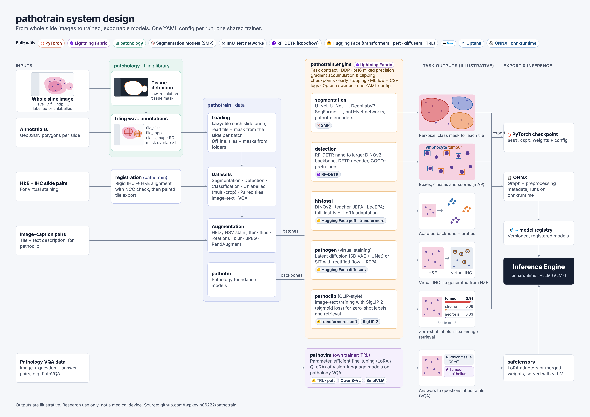

# pathotrain

<p align="center">
  
</p>

> [!WARNING]
> For research use only. Not a medical device.

Training on whole slide images (WSI), built on
[patchology](https://github.com/twpkevin06222/patchology) for tiling.

pathotrain turns whole slides and their annotations into tiles and trains
models on them: tissue segmentation, cell detection, virtual staining,
self-supervised pretraining of pathology foundation models, image-text models
for zero-shot classification and retrieval, and vision-language models for
pathology VQA. Every task runs from one YAML config on a shared trainer
(Lightning Fabric: one or more GPUs, mixed precision, checkpoints, early
stopping, MLflow and CSV logs, Optuna sweeps), and trained models export to ONNX (or Hugging Face safetensors for
the image-text and vision-language models) for inference.

## Installation

pathotrain is not on PyPI yet; install it from source in editable mode.
Python 3.12 or newer and an NVIDIA GPU are expected.

```bash
python -m venv .venv && source .venv/bin/activate

# 1. PyTorch built for CUDA 13.0 (the PyPI default build may not match your GPU driver)
pip install torch torchvision --index-url https://download.pytorch.org/whl/cu130

# 2. patchology (tiling), also not on PyPI
pip install "patchology @ git+https://github.com/twpkevin06222/patchology"
# or, from a local checkout: pip install -e ../patchology

# 3. pathotrain
git clone https://github.com/twpkevin06222/pathotrain.git
cd pathotrain
pip install -e .
```

The core install covers `segmentation`, `pathofm`, `dataloader`, `engine`,
`registration` and `experiment`. The other modules need an extra. The full
list of extras:

| Extra | Installs | Needed for |
|---|---|---|
| `detection` | rfdetr 1.11.2 (pinned), pycocotools, torch-hungarian | `pathotrain.detection` |
| `histossl` | peft | LoRA adaptation in `pathotrain.histossl` and `pathotrain.pathoclip` |
| `pathogen` | diffusers | `pathotrain.pathogen` |
| `pathovlm` | trl (pinned), peft, num2words | `pathotrain.pathovlm` |
| `export` | onnx, onnxruntime | ONNX export of any trained model |
| `all` | every extra above | everything |

```bash
pip install -e ".[detection]"          # one extra
pip install -e ".[detection,export]"   # a combination
pip install -e ".[all]"                # everything
```

Foundation-model weights (about 4.5 GB each) download from Hugging Face into
`~/.cache/huggingface` on first use; set `HF_HOME` to put them elsewhere. None
of them is gated, so no login is needed.

## Getting started

### System design



Slides and their annotations are tiled by patchology, loaded and augmented by
`pathotrain.dataloader`, and trained by a task module on the shared engine.
Trained models are saved as checkpoints and exported to ONNX (or safetensors
for VLMs) for inference.

### Train, evaluate, export

Each trainable module ships an example config. Copy it, set the data paths
and train:

```bash
cp src/pathotrain/segmentation/config.example.yaml my_run.yaml   # edit data paths
python -m pathotrain.segmentation.train my_run.yaml
python -m pathotrain.segmentation.eval runs/<name>/checkpoints/best.ckpt
python -m pathotrain.segmentation.export runs/<name>/checkpoints/best.ckpt model.onnx
```

Every run writes to its `output_dir`:

```
runs/<name>/
  config.yaml          the config as run (a changed config is refused unless resuming)
  train.log            console log
  checkpoints/         best.ckpt (weights + config), last.ckpt (full state, for --resume)
  logs/version_0/      metrics.csv, hparams.csv
```

Set `mlflow_db: ~/project/mlflow.db` in the config to also log to MLflow
(`mlflow ui --backend-store-uri sqlite:///$HOME/project/mlflow.db`).

Every run also logs its resource use under `system/`:

- **Every 10 s (MLflow):** CPU and GPU utilisation, system and GPU memory, GPU
  power, disk and network. Importing pathotrain sets
  `MLFLOW_ENABLE_SYSTEM_METRICS_LOGGING=1` unless you set it yourself, so every
  MLflow run in that process records them, including your own `mlflow.start_run()`.
  Export it as `0` to turn them off; set the interval with
  `MLFLOW_SYSTEM_METRICS_SAMPLING_INTERVAL`.
- **Per epoch, or per log in pathovlm (MLflow and CSV):**
  - PyTorch's peak GPU memory (`gpu_peak_allocated_gb`, `gpu_peak_reserved_gb`).
  - The FLOPs of one optimizer step, counted on the first micro-batch(es) (`step_tflop`).
  - The achieved TFLOP/s over the training time, data loading included
    (`achieved_tflops`).
  - With `trainer.peak_tflops` (the GPU's dense bf16 peak from its spec sheet),
    the model FLOPs utilisation (`mfu`).

The other modules follow the same pattern (`python -m pathotrain.<module>.train
config.yaml`); see each module's README for its data layout and options.

## Trainable modules

| Module | Task | Framework | Example config |
|---|---|---|---|
| [`segmentation`](src/pathotrain/segmentation/README.md) | Tissue / region segmentation from GeoJSON annotations | [segmentation_models_pytorch](https://github.com/qubvel-org/segmentation_models.pytorch) (U-Net, U-Net++, DeepLabV3+, UPerNet, SegFormer, ...), [nnU-Net](https://github.com/MIC-DKFZ/dynamic-network-architectures) networks, and `pathofm` backbones as encoders | `segmentation/config.example.yaml` |
| [`cellseg`](src/pathotrain/cellseg/README.md) | Nucleus segmentation and typing: semantic, instance (HoVer-Net style, PQ metrics, ONNX export) and a CellViT++ cell classifier | HoVer-Net, HoVer-NeXt and CellViT written from the papers, on timm ImageNet or `pathofm` encoders | `cellseg/configs/*.example.yaml` |
| [`pathocls`](src/pathotrain/pathocls/README.md) | Tile classification: a linear probe on a frozen foundation model (cached embeddings, or online with augmentation) or a fine-tuned one, exported to ONNX for pathoinfer | `pathofm` backbones (or histossl checkpoints) or timm models, with a linear or MLP head | `pathocls/config.example.yaml` |
| [`detection`](src/pathotrain/detection/README.md) | Cell / object detection | [RF-DETR](https://github.com/roboflow/rf-detr) nano to large (DINOv2 backbone, DETR decoder), COCO-pretrained | `detection/config.example.yaml` |
| [`pathogen`](src/pathotrain/pathogen/README.md) | Virtual staining (e.g. H&E to IHC) from registered tile pairs | [diffusers](https://github.com/huggingface/diffusers): latent diffusion with a frozen SD VAE and a UNet (DDPM / DDIM), or SiT with rectified flow and REPA | `pathogen/config.example.yaml` |
| [`histossl`](src/pathotrain/histossl/README.md) | Self-supervised (continued) pretraining of pathology foundation models | DINOv2 (DINO + iBOT + KoLeo / KDE, incl. the OpenMidnight recipe), teacher-JEPA, LeJEPA; full, last-N or LoRA ([peft](https://github.com/huggingface/peft)) adaptation; linear, kNN and dense probes | `histossl/configs/*.example.yaml` |
| [`pathoclip`](src/pathotrain/pathoclip/README.md) | Image-text contrastive fine-tuning on pathology captions, for zero-shot tile classification and image-text retrieval | [transformers](https://github.com/huggingface/transformers) SigLIP 2 (base, so400m) with its sigmoid loss, LoRA ([peft](https://github.com/huggingface/peft)) or full, on one or both towers; or a frozen `pathofm` image tower (LiT) with cached embeddings; ARCH data | `pathoclip/configs/*.example.yaml` |
| [`pathovlm`](src/pathotrain/pathovlm/README.md) | VLM fine-tuning and post-training for pathology VQA | [transformers](https://github.com/huggingface/transformers) Qwen3-VL and SmolVLM2 with LoRA ([peft](https://github.com/huggingface/peft)); [TRL](https://github.com/huggingface/trl) stages: SFT, DPO / MPO, KTO, GRPO / GSPO, RLOO, on-policy distillation, online DPO; logged like the other modules; PathVQA data | `pathovlm/configs/*.example.yaml` |

## Helper modules

These support the trainable modules and have no training of their own.

| Module | What it provides |
|---|---|
| [`dataloader`](src/pathotrain/dataloader/README.md) | PyTorch datasets for slides and tiles: segmentation (GeoJSON masks), detection, classification (class folders or CSV), unlabelled tiles with multi-crop views, paired tiles, VQA image-question-answer rows (with a PathVQA converter); tile export to disk; augmentation (HED / HSV stain jitter, flips, rotations, blur, JPEG, RandAugment) |
| `engine` | The trainer all tasks share: `Task` contract, `Trainer` on Lightning Fabric (devices, DDP, mixed precision, gradient accumulation and clipping), `ModelCheckpoint` / `EarlyStopping` callbacks, MLflow and CSV loggers, warmup-cosine schedule, Optuna `sweep`, YAML config loading |
| [`pathofm`](src/pathotrain/pathofm/README.md) | Pathology foundation models as frozen or trainable backbones, with their model-card preprocessing and tile / dense embeddings (see below) |
| [`registration`](src/pathotrain/registration/README.md) | Rigid alignment of a non-H&E slide (IHC, special stain) to its H&E slide, with an overlay check; feeds paired tiles to `pathogen` |
| `experiment.py` | The plumbing behind every config-driven `train` / `eval` / `export` command: `start` (copy the config, start `train.log`, seed), `fit` (wire trainer, callbacks, loggers and data loaders from the config), `evaluate` / `log_eval`, `export_onnx` (ONNX graph with its preprocessing metadata) and `register_onnx` (MLflow model registry), and config `normalisation` presets |

### Foundation models in `pathofm`

Only open models: MIT or Apache-2.0, not gated. Revisions are pinned, so the
weights never change under a run.

| Name | Weights | Architecture | Normalisation |
|---|---|---|---|
| `midnight-12k` | [kaiko-ai/midnight](https://huggingface.co/kaiko-ai/midnight) | DINOv2 ViT-g/14, 1.1B parameters | mean = std = 0.5 |
| `spectra-midnight-12k` | [medarc/Midnight-12k-SPECTRA](https://huggingface.co/medarc/Midnight-12k-SPECTRA) | as midnight-12k, tuned for scanner, stain and centre robustness | mean = std = 0.5 |
| `openmidnight-1.1` | [medarc/OpenMidnight-1.1](https://huggingface.co/medarc/OpenMidnight-1.1) | DINOv2 ViT-g/14 with 4 registers, converted from timm on load | ImageNet |

```python
from pathotrain.pathofm import build_encoder

backbone, transform = build_encoder("openmidnight-1.1")  # model + its model-card preprocessing
```

## Logging

Logs (via loguru) show `INFO` and above by default. Each library has its own
level, so you can turn one up without the other:

```bash
export PATHOTRAIN_LOG_LEVEL=DEBUG    # pathotrain: DEBUG, ALL for everything, WARNING for less
export PATCHOLOGY_LOG_LEVEL=WARNING  # patchology (tiling) messages
```

If your application configures loguru itself (removes the default handler
before importing pathotrain), that setup is left untouched.

## License

Apache License 2.0, see [LICENSE](LICENSE).
