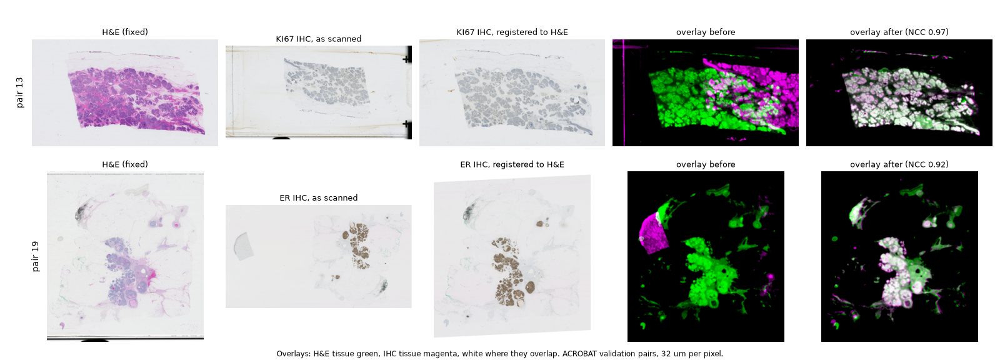

# pathotrain - registration

> [!WARNING]
> For research use only. Not a medical device.

Align a non-H&E slide (IHC, special stain) to its H&E slide, so both can be
tiled over the same tissue, e.g. for virtual staining with
`pathotrain.pathogen`. A helper, not a trained model: no extra dependencies
beyond OpenCV and torch.



Two ACROBAT validation pairs. The IHC slides come in turned 180 degrees and
shifted on the glass; after registration their tissue lies on the H&E's
(overlays: H&E tissue green, IHC magenta, white where they overlap).

```bash
python -m pathotrain.registration.affine HE.tiff IHC.tiff reg.json --overlay reg.jpg
```

```python
from pathotrain.registration import Registration, register

reg = register("he_slides/0_HE_val.tiff", "ihc_slides/0_KI67_val.tiff")
reg.ncc  # alignment check, see below
reg.to_moving([[x, y]])  # H&E level-0 point -> IHC level-0 point
reg.save("reg.json")
reg = Registration.load("reg.json")
```

Then tile both slides with
`pathotrain.dataloader.registration.export_registered_tiles` (see the
dataloader README).

## Batch: register and tile folders of pairs

```bash
python -m pathotrain.registration.batch he_slides/ ihc_slides/ tiles/train \
    --tile-size 1024 --tile-mpp 1.0
```

- Slides pair by `--key`, a regex on the file stem (default `^[^_]+`, the text
  before the first `_`: `0_HE_val.tiff` with `0_KI67_val.tiff`); unpaired
  slides are skipped with a warning.
- Writes `registrations/<H&E stem>.json` and `.jpg` (overlay) per pair, the
  tile pairs in `source/` and `target/` (ready for `data.<split>` of a pathogen
  config), `tiles/<H&E stem>.csv`, and `registrations.csv` (NCC, status and
  tile count per pair).
- Pairs below `--min-ncc` (0.55) are registered but not tiled: check their
  overlays, and rerun with a lower `--min-ncc` to tile the good ones.
- Reruns reuse saved registrations and skip slides already tiled, so an
  interrupted batch resumes. `--tissue-overlap` (H&E) and
  `--min-target-tissue` (IHC, default 0.1) set which tiles are kept.
- One output folder per split: split slides by patient into separate folders
  first, or run per split.
- On one RTX 5090, ACROBAT pairs took ~6 s to register and 25-75 s to tile at
  1024 px, 1 um per pixel (60-250 tile pairs each).

## How it works

The H&E is fixed; the other slide moves onto it with one affine transform.

1. Both slides are read at 16 um per pixel (`mpp`) and turned into the same
   kind of image whatever the stain: optical density, kept on tissue only
   (glass, labels and slide edges removed) and rank-equalised, so a pale
   haematoxylin counterstain and a dark H&E look alike.
2. Rigid search at 64 um per pixel: both mirror images, every 4 degrees of
   rotation, and every translation at once by FFT cross-correlation (on the GPU
   when present). Sections are often turned or flipped relative to each other.
3. The 5 best poses are refined to a full affine (scale, shear) with ECC at
   32 um per pixel.
4. The pose whose aligned images correlate best (normalised cross-correlation,
   NCC) wins, is refined again at 16 um per pixel, and is saved as a 2 x 3
   matrix from H&E level-0 pixels to the other slide's level-0 pixels.

**Checking a result.** NCC is 1 for identical images and ~0 for unrelated ones.
`register` warns below 0.55; look at the `--overlay` image (H&E tissue green,
the other slide magenta, white where they overlap).

## Results on ACROBAT

Using ACROBAT validation set as a benchmark stress test. 

ACROBAT validation (100 H&E / IHC breast cancer pairs: ER, PGR, HER2, KI67;
many turned 180 degrees, IHC slides with extra control tissue):

- 87 pairs visibly aligned in the overlays, 4 misaligned (23, 46, 67, 79: the
  IHC control tissue was placed on the H&E tissue), and 9 undecided because
  their IHC tissue is too pale to see at 16 um per pixel.
- NCC median 0.79 (0.32 to 0.97). The 4 misaligned pairs scored 0.36 to 0.51,
  so the 0.55 warning flags all of them, and 7 others (6 aligned, 1 undecided).
- 5.9 s per pair on one RTX 5090 (slide reading, tissue images, search and
  ECC).

ACROBAT keeps the validation landmarks of the H&E slides hidden, so these
pairs were judged from overlays, not by landmark error. To score against the
landmarks, submit transformed points on
[acrobat.grand-challenge.org](https://acrobat.grand-challenge.org).

## Limits

- One affine per slide pair: tissue that stretched, tore or folded
  differently keeps its local offset. Accuracy in microns is not measured
  (no landmarks); it works at 16 um per pixel, so it is meant for pairing
  tiles over the same tissue, not for cell-level correspondence.
- Assumes one main piece of tissue shared by both slides. Small extra pieces
  (IHC control tissue) are usually tolerated, but can win when the shared
  tissue is pale or small (the ACROBAT failures above); slides with several
  sections in a different arrangement are not handled.

## Tests

```bash
uv run pytest packages/pathotrain/tests/test_registration.py
```
